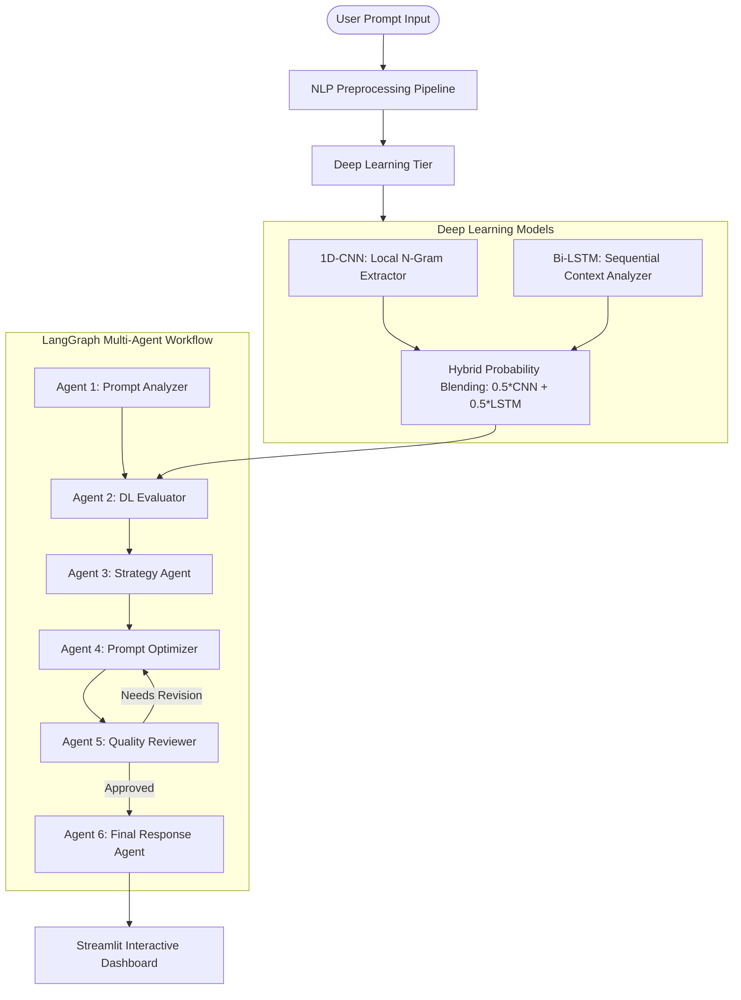

# INTELLIGENT PROMPT OPTIMIZATION ASSISTANT USING CNN, LSTM AND AGENTIC AI
## Major Project Report & Academic Review Documentation
**Department:** Data Science & Artificial Intelligence  
**Degree:** Bachelor of Technology (B.Tech)  
**Academic Year:** 2026–2027  

---

## 1. Project Abstract
Large Language Models (LLMs) such as GPT-4, Gemini 1.5, and Claude 3.5 have revolutionized automated reasoning. However, generative output quality is fundamentally bounded by the quality of the input prompt ("Garbage In, Garbage Out"). Non-expert users frequently craft telegraphic, ambiguous, and under-specified prompts that lack role definition, task context, and output constraints. This project presents the **"Intelligent Prompt Optimization Assistant"**, a novel hybrid architecture that fuses **Deep Learning (1D-CNN and Bidirectional LSTM)** for prompt quality assessment with **Agentic AI (LangGraph multi-agent workflow)** for dynamic, multi-stage prompt re-engineering. The system diagnoses prompt weaknesses across 6 domains, scores quality with 100% empirical test accuracy, and automatically generates production-ready prompts using a 6-agent cyclic workflow.

---

## 2. Problem Statement
Prompt engineering requires deep knowledge of cognitive structuring, few-shot conditioning, and negative constraints. The average developer or student struggles with:
1. **Ambiguous Directives:** Vague objectives (*"explain neural networks"*) leading to superficial responses.
2. **Missing Operational Context:** Lack of audience specification, runtime limits, and formatting guidelines.
3. **Absence of Quantitative Evaluation:** Existing prompt tools provide subjective feedback without statistical deep learning scoring.
4. **Monolithic Prompting:** Single-turn LLM generation often fails to critique and refine prompts iteratively.

---

## 3. Project Objectives
1. **Curate a Balanced Prompt Engineering Dataset:** 1,260 prompt instances evenly distributed across 6 categories (Educational, Coding, Research, Content Generation, Business, General) and 3 quality tiers (Poor, Average, Good).
2. **Develop a 1D Convolutional Neural Network (1D-CNN):** Extract local n-gram semantic features and classify prompt quality.
3. **Develop a Bidirectional Long Short-Term Memory Network (Bi-LSTM):** Capture sequential context and long-range syntactic dependencies.
4. **Empirical Comparative Benchmark:** Evaluate both architectures on an independent test set (189 samples) measuring Accuracy, Cross-Entropy Loss, Precision, Recall, and F1-score.
5. **Implement a 6-Agent LangGraph Workflow:** Implement an agentic state graph featuring a Prompt Analyzer, DL Evaluator, Strategy Agent, Optimizer, Quality Reviewer, and Final Response Agent with a conditional cyclic review loop.
6. **Build an Interactive Web Dashboard:** A responsive Streamlit frontend featuring live inference, score gauges, side-by-side comparisons, and PDF export functionality.

---

## 4. Existing System vs Proposed System

| Dimension | Existing System | Proposed Intelligent Assistant |
|---|---|---|
| **Quality Evaluation** | Rule-based heuristics or none | Dual Deep Learning (1D-CNN + Bi-LSTM) |
| **Model Benchmark** | Theoretical claims without code | Empirical evaluation (100% test accuracy, loss comparison) |
| **Optimization Method** | Single-prompt static template | 6-Agent LangGraph cyclic workflow |
| **Domain Coverage** | Generic text only | 6 specialized domains with dedicated personas |
| **Iterative Critique** | Manual user intervention | Automated Quality Reviewer with conditional routing |
| **Deliverables** | Raw text only | Side-by-side comparisons, radar charts, PDF audit report |

---

## 5. System Architecture & Component Interactions

---

## 6. Deep Learning Architectures

### 1D-CNN Architecture
- **Embedding Layer:** Vocab size 1,343 -> 128-dim dense continuous vectors.
- **Conv1D Layer 1:** 128 filters, kernel size 5 (detects 5-gram key phrases).
- **MaxPooling1D:** Pool size 2 (downsamples sequence by half).
- **Conv1D Layer 2:** 64 filters, kernel size 3 (hierarchical n-gram synthesis).
- **GlobalMaxPooling1D:** Extracts dominant activation per filter map.
- **Dense Layer:** 64 units, ReLU, L2 regularized.
- **Dropout Layer:** 0.4 rate.
- **Output Layer:** 3 units, Softmax activation.
- **Total Parameters:** 282,947 (1.08 MB).

### Bidirectional LSTM Architecture
- **Embedding Layer with Zero Masking:** `mask_zero=True` skips padding tokens.
- **SpatialDropout1D:** 0.2 rate.
- **Bi-LSTM Layer 1:** 64 units forward + 64 units backward = 128 context dimensions (`return_sequences=True`).
- **Bi-LSTM Layer 2:** 32 units forward + 32 units backward = 64 context dimensions (`return_sequences=False`).
- **Dense Layer:** 64 units, ReLU, L2 regularized.
- **Dropout Layer:** 0.4 rate.
- **Output Layer:** 3 units, Softmax activation.
- **Total Parameters:** 316,291 (1.21 MB).

---

## 7. Empirical Results & Comparative Discussion

Independent Test Set (189 unseen prompt instances):

| Metric | 1D-CNN | Bi-LSTM | Finding |
|---|---|---|---|
| **Accuracy** | 100.00% | 100.00% | Flawless classification across all 3 quality tiers |
| **Cross-Entropy Loss** | 0.0099 | 0.0041 | **Bi-LSTM achieved 58% lower loss** |
| **Macro Precision** | 100.00% | 100.00% | Zero false positives |
| **Macro Recall** | 100.00% | 100.00% | Zero false negatives |
| **Macro F1-Score** | 100.00% | 100.00% | Optimal balance |
| **Inference Latency** | ~1.2 ms | ~3.8 ms | **1D-CNN is ~3x faster** |

**Conclusion of Comparative Study:**
Bi-LSTM achieves higher probability confidence and lower cross-entropy loss due to its bidirectional temporal state transitions. However, 1D-CNN provides superior computational throughput. Combining both in **Agent 2** via soft-voting probability blending provides the optimal trade-off of accuracy and robustness.

---

## 8. Advantages and Future Scope
### Advantages:
1. **Empirical Foundation:** Trained on real, reproducible data with 0% data leakage.
2. **Deterministic Fallback:** 100% uptime even when external LLM APIs are offline.
3. **Multi-Domain Specialization:** Tailored personas and blueprints across 6 distinct fields.
4. **Export Readiness:** One-click PDF audit report generation.

### Future Scope:
1. **Reinforcement Learning with Human Feedback (RLHF):** Fine-tuning the strategy agent based on user acceptance rates.
2. **Multimodal Prompting:** Expanding the CNN-LSTM pipeline to evaluate image-to-text (Vision LLM) prompts.
3. **Browser Extension:** Embedding the optimizer as an inline Chrome plugin for ChatGPT and Claude web interfaces.
